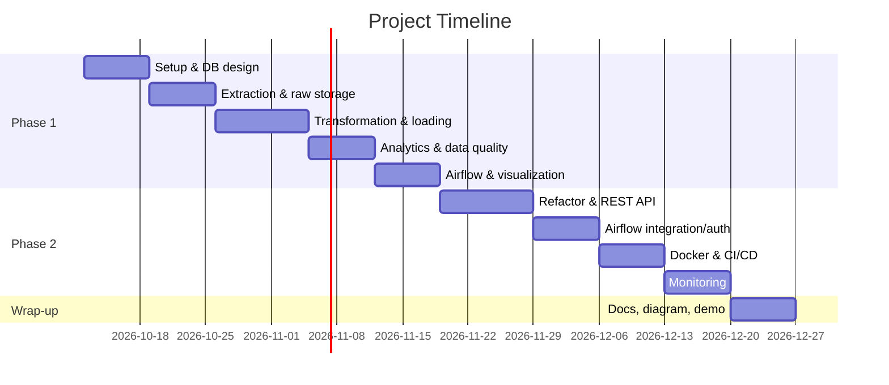

# Project Planning & Management

## 1. Project Proposal

**Overview:** A two-phase data engineering project. Phase 1 builds an automated ETL pipeline that collects financial market data from an external API, transforms it, and stores it in PostgreSQL. Phase 2 turns that pipeline into a containerized, monitored, API-accessible service.

**Objectives:**
- Deliver a reliable, scheduled pipeline with incremental loading
- Produce analytical datasets (returns, moving averages, volume statistics)
- Expose the pipeline through a secured REST API
- Automate build, deployment, and monitoring

**Scope:**
- In scope: ingestion, validation, transformation, storage, analytics, orchestration, API, Docker, CI/CD, monitoring
- Out of scope: trading logic, real-time streaming, frontend application
- Optional: MongoDB raw storage, Terraform

---

## 2. Project Plan

### Timeline (Gantt Chart)

### Milestones

| Milestone | Description |
|---|---|
| M1 | Phase 1 working end to end |
| M2 | REST API connected to Airflow |
| M3 | Dockerized with CI/CD |
| M4 | Monitoring dashboard live |
| M5 | Final documentation and demo |

### Deliverables

- **Phase 1:** scripts, database, ERD, DAG, data-quality report, SQL queries, visualization, README
- **Phase 2:** REST API, Dockerfile, GitHub repo, CI/CD workflow, monitoring dashboard, API docs
- **Final:** unified architecture diagram and README

### Resource Allocation

| Resource | Use |
|---|---|
| Python, Pandas | ETL |
| PostgreSQL | Storage |
| Airflow | Orchestration |
| FastAPI | REST API |
| Docker | Containerization |
| GitHub Actions | CI/CD |
| Prometheus, Grafana | Monitoring |

---

## 3. Task Assignment & Roles

| Role | Responsibility | Assigned To |
|---|---|---|
| Project Lead | Planning, coordination, final delivery | TBD |
| Data Engineer | Extraction, transformation, loading | TBD |
| Database Engineer | Schema, ERD, SQL analytics | TBD |
| Orchestration Engineer | Airflow DAG and integration | TBD |
| Backend Engineer | REST API, authentication | TBD |
| DevOps Engineer | Docker, CI/CD, monitoring | TBD |
| Documentation Lead | README, diagrams, reports | TBD |

---

## 4. Risk Assessment & Mitigation Plan

| Risk | Impact | Mitigation |
|---|---|---|
| API rate limits or downtime | High | Retry logic, backoff, cached raw data |
| Inconsistent or missing data | Medium | Validation and cleaning rules |
| Duplicate records on reload | Medium | Incremental loading with unique keys |
| Airflow setup complexity | Medium | Docker Compose, start simple |
| Scope creep | High | Finish Phase 1 before Phase 2 |
| Team availability | Medium | Clear roles, weekly check-ins |
| Credentials exposed in code | High | Environment variables, .gitignore |
| Deployment failures | Medium | CI tests before deploy |

---

## 5. KPIs

| KPI | Target |
|---|---|
| Pipeline success rate | ≥ 95% of scheduled runs |
| API response time | < 500 ms for status endpoints |
| System uptime | ≥ 99% during demo period |
| Data quality | < 1% invalid or duplicate records |
| Test coverage | ≥ 70% |
| CI/CD pass rate | All merges pass the pipeline |
| Deliverables completed | 100% by final milestone |
| Alert response | Failures visible in Grafana within 1 minute |